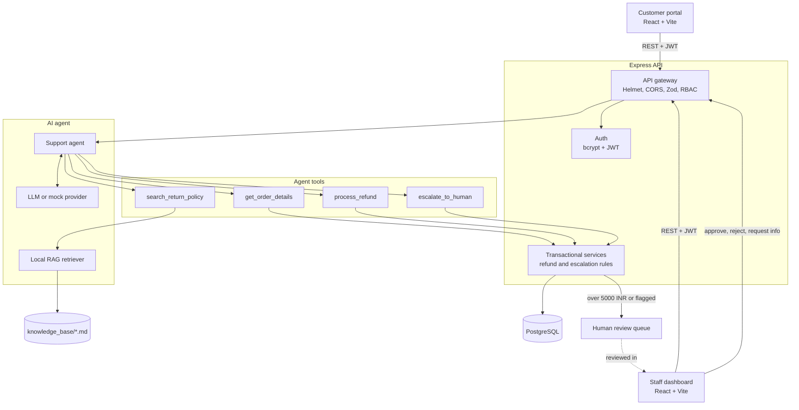

## Architecture Diagram

### How it works

1. **Frontend:** Customers use the customer portal to chat with support. Staff use the staff dashboard to review cases. Both talk to the backend over REST, using a JWT to prove who they are.

2. **API gateway:** Every request goes through one entry point. It checks security, validates the input, and enforces roles, so a customer can't use staff features.

3. **AI agent:** When a customer sends a message, the agent reads it and decides what to do. It uses either a real LLM or a built-in mock, so the app also works without an API key.

4. **Agent tools:** The agent can only act through four tools: look up an order, search the return policy, process a refund, or escalate to a human. The policy search reads the markdown files in the knowledge base, so answers come with citations.

5. **Transactional services:** The tools don't change data directly. They go through backend services that check ownership, the return window, the refund limit, and duplicate requests. Even if the AI is tricked, these rules still apply.

6. **PostgreSQL:** All data is stored here: orders, tickets, messages, refunds, escalations, and audit logs.

7. **Human review:** If a refund is over ₹5,000 or flagged, it goes to the review queue instead of being auto-approved. Staff open it in the dashboard and approve, reject, or ask for more info. Their decision goes back through the same services, and the action is saved in the audit log.
